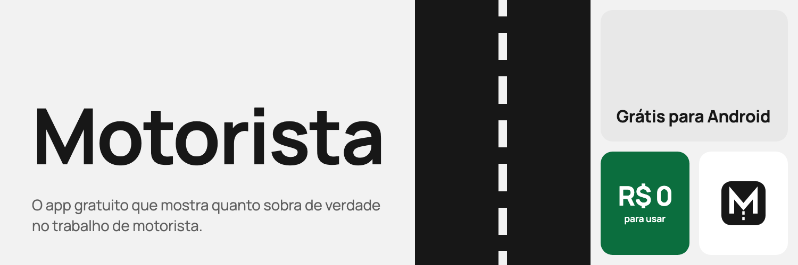
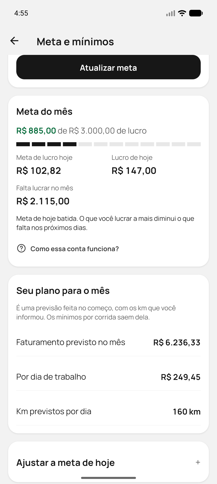

<p align="center">
  <picture>
    <source media="(prefers-color-scheme: dark)" srcset="docs/imagens/banner-escuro.png" />
    
  </picture>
</p>

<div align="center">

  **Sem conta. Sem cobrança. Sem anúncios. Seus dados ficam só no seu celular.**

  [](https://github.com/Dev-Etto/motorista/releases/latest)
  
  
  [](LICENSE)

  [**Baixar o APK para Android**](https://github.com/Dev-Etto/motorista/releases/latest/download/motorista.apk) · [Todas as versões](https://github.com/Dev-Etto/motorista/releases) · [Relatar um problema ou sugerir uma melhoria](https://github.com/Dev-Etto/motorista/issues/new/choose) · [Apoiar o projeto](https://buymeacoffee.com/contatodevj)

</div>

<p align="center">
  
  
  
  
  
</p>

<p align="center">
  
  
  
  
</p>

## Nesta página

- [Por que este projeto existe](#por-que-este-projeto-existe)
- [O que o app faz](#o-que-o-app-faz)
- [Como começar](#como-começar)
- [Como as contas funcionam](#como-as-contas-funcionam)
- [Como instalar](#como-instalar)
- [Situação de cada recurso](#situação-de-cada-recurso)
- [Privacidade e permissões](#privacidade-e-permissões)
- [Perguntas frequentes](#perguntas-frequentes)
- [Problemas e sugestões](#problemas-e-sugestões)
- [Contribua com o projeto](#contribua-com-o-projeto)
- [Para desenvolvedores](#para-desenvolvedores)
- [Licença](#licença)

## Por que este projeto existe

Motorista já tem custo demais: combustível, manutenção, seguro, parcela ou aluguel. Uma ferramenta para entender esses números não deveria ser mais um boleto.

O Motorista quer democratizar esse tipo de app. Ele é uma opção profissional e gratuita para quem trabalha com aplicativo ou viagens particulares entender o custo real, cobrar melhor, buscar boas margens e ter mais organização e previsibilidade.

## O que o app faz

### Saber quanto sobra

- **Custo real por km:** combustível, manutenção, pneus, seguro, IPVA, parcela ou aluguel.
- **Lucro de verdade:** por dia, semana, mês e ano, por km e por hora.
- **Jornadas:** cronômetro, km medidos por GPS e ganhos por plataforma.
- **Despesas:** pedágio, alimentação, abastecimentos e manutenção.
- **Relatórios:** gráficos por período e o Mês fechado, que mostra se você rodou o suficiente para pagar os custos fixos.

### Planejar o mês

- **Meta por lucro:** você diz quanto quer lucrar, e o app acompanha o lucro real, mostra quanto lucrar hoje e quanto falta no mês.
- **Mínimos por corrida:** calcula o menor valor que cada corrida deve pagar, por km e por hora, a partir do seu plano.
- **Calculadoras:** avaliação de ofertas e preço de corridas particulares.

### Avaliar ofertas com o Copiloto

- **Nota de 0 a 5:** lê a oferta na tela da Uber, da 99 ou do inDrive e avalia com base no seu custo e nos seus mínimos.
- **Do seu jeito:** por voz, cartão na tela, botão flutuante ou notificação.
- **Faturamento estimado:** soma as corridas que você aceitou, por app, como sugestão para conferir ao registrar a jornada. As ofertas ficam guardadas por até 12 meses, com filtros de período, app e resultado.

### No dia a dia

- **Lembretes:** de manutenção e do fim do dia.
- **Backup em arquivo:** para guardar seus dados e levá-los para outro celular.
- **Visual limpo:** preto, branco e cinza, com cor só onde ela informa, como no lucro e na nota da oferta. Tem tema claro e escuro.

### Você sempre decide

O Copiloto só lê e informa. Ele nunca toca na tela, nunca aceita nem recusa corridas e não envia mensagens. Cada plataforma tem suas próprias regras sobre apps de apoio, e vale conhecê-las.

**Dirigindo, use a voz e não mexa no celular.** Configure e consulte o app só com o carro parado.

## Como começar

1. **Cadastre o veículo:** informe consumo, km previstos no mês e os custos que você conhece. O app começa com estimativas, e quanto mais valores reais você informar, mais preciso fica o resultado.
2. **Defina a meta:** diga quanto quer lucrar no mês e quais dias trabalha.
3. **Registre as jornadas:** informe ganhos, km e horas, com o carro parado, ou use o cronômetro e o GPS.
4. **Ligue o Copiloto, se quiser:** em Mais, abra Copiloto de ofertas e siga a configuração guiada.

A tela de Ajuda, em Mais, explica cada conta e cada recurso.

## Como as contas funcionam

### Custo e lucro

- **Custo por km:** soma combustível, óleo, pneus e manutenção por km, e divide os custos fixos do mês pelos km que você prevê rodar.
- **Lucro:** é o faturamento menos o custo do veículo pelos km rodados e as despesas. Abastecimentos e manutenção não saem do lucro de novo, porque já estão no custo por km.

### Meta do mês

A meta mede o lucro, não o faturamento: o mesmo valor de "Neste mês", no início. A meta de hoje divide o que faltava no começo do dia pelos dias de trabalho restantes e não muda durante o dia.

Já o Mês fechado, em Relatórios, desconta o custo fixo inteiro. Por isso os dois podem ser diferentes quando você roda mais ou menos que o previsto.

Por exemplo, com meta de R$ 3.000, custos fixos de R$ 1.000, R$ 0,50 de custo variável por km e 4.000 km previstos, o custo fica em R$ 0,75 por km:

| Faturou | Rodou | Lucro na meta | Lucro no Mês fechado |
| --- | --- | --- | --- |
| R$ 6.000 | 4.000 km | R$ 3.000 (100%) | R$ 3.000 |
| R$ 6.000 | 6.000 km | R$ 1.500 (50%) | R$ 2.000 |
| R$ 5.000 | 2.000 km | R$ 3.500 (meta batida) | R$ 3.000 |

### Nota da oferta

A nota compara a oferta com seu custo e seus mínimos de R$/km e R$/hora.

| Cor | Nota | O que significa |
| --- | --- | --- |
| Verde | 3,5 ou mais | Atinge os dois mínimos. Quanto mais acima deles, maior a nota |
| Amarelo | De 2 a 3,4 | Cobre seu custo, mas fica abaixo de algum mínimo |
| Vermelho | Até 1,9 | Não cobre seu custo por km |

Quando a oferta não mostra o tempo da corrida, a nota usa só o valor por km e vai no máximo até 4. Sem custos cadastrados, a oferta aparece sem nota.

## Como instalar

Funciona em celulares com **Android 8 ou mais novo**.

1. Toque em [**Baixar o APK**](https://github.com/Dev-Etto/motorista/releases/latest/download/motorista.apk) no celular Android.
2. Abra o arquivo baixado e permita a instalação quando o Android pedir.
3. Abra o Motorista e siga a introdução.

Para atualizar, instale a versão nova por cima da atual. Em Mais, Verificar atualização abre o download no navegador. Seus dados continuam no aparelho, mas vale fazer um backup antes.

O app é distribuído fora das lojas, então o Android pode mostrar avisos extras durante a instalação. Para o Copiloto, o Android também pede a liberação de configurações restritas e da acessibilidade. O passo a passo aparece dentro do app.

Cada versão publicada traz o SHA-256 do APK nas [notas da versão](https://github.com/Dev-Etto/motorista/releases), para quem quiser conferir o arquivo.

## Situação de cada recurso

O Motorista está em **versão piloto**, sendo testado com motoristas.

| Recurso | Situação |
| --- | --- |
| Custos, jornadas, despesas e relatórios | Pode ser usado |
| Meta do mês e mínimos por corrida | Pode ser usado |
| Calculadoras, lembretes e backup | Pode ser usado |
| Leitura automática de ofertas | Em validação com ofertas reais. Pode falhar em alguns aparelhos ou versões das plataformas |
| Faturamento estimado | Em validação. É uma sugestão: o app não sabe se o passageiro cancelou nem quanto a plataforma pagou no fim |

Para ajudar na validação, abra Copiloto de ofertas, Calibração, ligue Ver o que o Copiloto lê, aceite e recuse uma oferta e toque em Enviar estas leituras.

## Privacidade e permissões

- Não há conta nem servidor.
- O APK não tem permissão de internet: seus dados não saem do aparelho pelo app.
- Links como este repositório e a página de doação abrem no seu navegador.
- O backup só sai do celular quando você compartilha o arquivo. Ele não tem senha, então guarde em um lugar só seu.
- Os resultados são estimativas feitas com os dados que você informa. Não são aconselhamento financeiro nem fiscal.

O que o app pode pedir ao Android, e para quê:

| Permissão | Para que serve |
| --- | --- |
| Acessibilidade | Ler as ofertas e perceber o toque em aceitar ou recusar, só na Uber, na 99 e no inDrive. Não executa toques |
| Sobrepor outros apps | Mostrar o cartão da oferta e o botão flutuante |
| Localização | Medir os km por GPS, só com a medição ligada. O app não pede localização em segundo plano |
| Notificações | Enviar lembretes e, se você escolher, mostrar as ofertas |
| Iniciar com o celular | Manter os lembretes depois de reiniciar o aparelho |

O app também não tem permissão de câmera, microfone nem de acesso aos arquivos do celular. A cada versão, uma verificação automática impede que o APK saia com permissões fora da lista aprovada do projeto.

## Perguntas frequentes

**É grátis mesmo?**
Sim. Não tem assinatura, recurso pago nem anúncios. O projeto se mantém com apoio voluntário.

**Funciona no iPhone?**
Não. Por enquanto, o app é só para Android.

**Preciso de internet?**
Não. Tudo é calculado e guardado no próprio celular.

**O app aceita corridas sozinho?**
Não. O Copiloto só lê e informa, e a decisão é sempre sua.

**Por que o lucro é menor que o que recebi?**
Porque o app desconta o custo do veículo pelos km rodados e as despesas. É o que sobra de verdade depois de pagar para trabalhar.

**Por que a barra da meta anda menos quando rodo mais?**
Porque mais km pelo mesmo valor significam mais custo e menos lucro.

**Vou perder meus dados ao atualizar?**
Não: instale por cima da versão atual. Antes, vale fazer um backup. Se desinstalar o app, os dados saem junto.

**Como troco de celular?**
Faça um backup, guarde o arquivo fora do aparelho, instale o app no celular novo, abra Backup e use Restaurar.

**O Copiloto não aparece. O que faço?**
Confira se a acessibilidade continua ativa e retire o app da otimização de bateria. Se a oferta não for reconhecida, a Calibração mostra o que o Copiloto está lendo, com as palavras mascaradas.

## Problemas e sugestões

Encontrou um problema ou teve uma ideia? No app, abra Mais e toque em Relatar um problema: você revisa o texto e envia por onde quiser, como o WhatsApp. Se preferir o GitHub, use os links abaixo, com uma conta gratuita.

- [**Relatar um problema**](https://github.com/Dev-Etto/motorista/issues/new?template=problema.yml)
- [**Sugerir uma melhoria**](https://github.com/Dev-Etto/motorista/issues/new?template=sugestao.yml)

## Contribua com o projeto

O Motorista é gratuito, e você pode ajudar a mantê-lo e a levar novos recursos para mais motoristas, com código ou com apoio financeiro.

- **Com código:** veja a seção [Para desenvolvedores](#para-desenvolvedores) e as [issues abertas](https://github.com/Dev-Etto/motorista/issues).
- **Com apoio financeiro:** use o QR code abaixo ou acesse [buymeacoffee.com/contatodevj](https://buymeacoffee.com/contatodevj).

<p align="center">
  <a href="https://buymeacoffee.com/contatodevj"></a>
</p>

## Para desenvolvedores

Feito com Expo 58, React Native 0.88, TypeScript, SQLite e um módulo nativo em Kotlin. Você precisa do Node 22 e do Android SDK. As decisões técnicas e as regras de código estão em [docs/arquitetura.md](docs/arquitetura.md).

```text
src/
  app/        Rotas. Só reexportam telas
  features/   Telas, hooks e componentes de cada funcionalidade
  domain/     Regras de negócio puras, sem React, banco ou Expo
  data/       SQLite, migrações, repositórios e backup
  shared/     Tema, componentes, hooks e utilitários genéricos
modules/
  copilot/    Módulo nativo: acessibilidade, cartão, voz e botão flutuante
```

```bash
npm install
npm run typecheck
npm test
npm run lint
npm run android
```

Os testes do módulo nativo rodam depois de gerar a pasta `android`:

```bash
npx expo prebuild --platform android --no-install
cd android && ./gradlew :copilot:testDebugUnitTest
```

Para testar o Copiloto sem uma oferta real, use `npm run android`, depois `npm run mock -- setup` e `npm run mock -- uber`. O comando `npm run mock` lista as outras opções. As ofertas são simuladas e funcionam só em build de debug.

`npm run build:apk` roda as verificações, gera o APK assinado em `dist/motorista.apk` e confere as permissões dele. Ele exige uma chave de assinatura própria, indicada pelas variáveis `MOTORISTA_KEYSTORE` e `MOTORISTA_KEYSTORE_PASSWORD`.

## Licença

O código é aberto para consulta, estudo e melhorias, mas **a comercialização é proibida**. A licença é a [PolyForm Noncommercial 1.0.0](LICENSE), com uma permissão adicional para motoristas.

- **Pode:** usar o app no seu trabalho de motorista, mesmo sendo remunerado, além de estudar, alterar e compartilhar gratuitamente, mantendo a licença e o aviso de autoria.
- **Não pode:** vender ou alugar o app ou versões derivadas, cobrar por acesso, instalação, recursos ou suporte, exibir anúncios ou incluí-lo em produto ou serviço pago.

Este resumo não substitui o texto do arquivo [LICENSE](LICENSE).

A fonte Manrope, incluída no app, é distribuída sob a [SIL Open Font License](assets/fonts/OFL.txt). Os termos de uso e a política de privacidade ficam dentro do app, em Mais.

Motorista é um projeto independente, sem vínculo com Uber, 99, inDrive ou outras plataformas. As marcas citadas pertencem aos seus donos.
