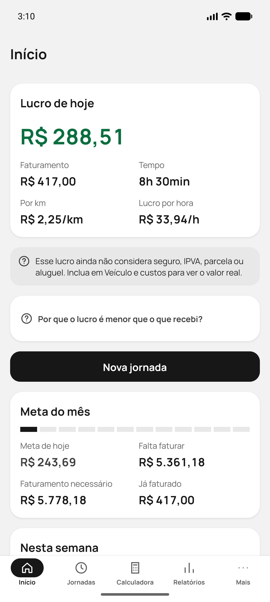
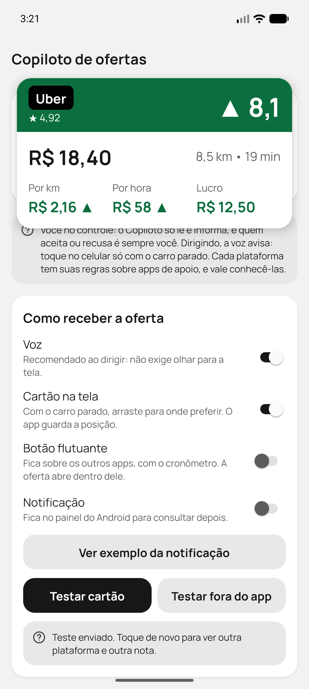
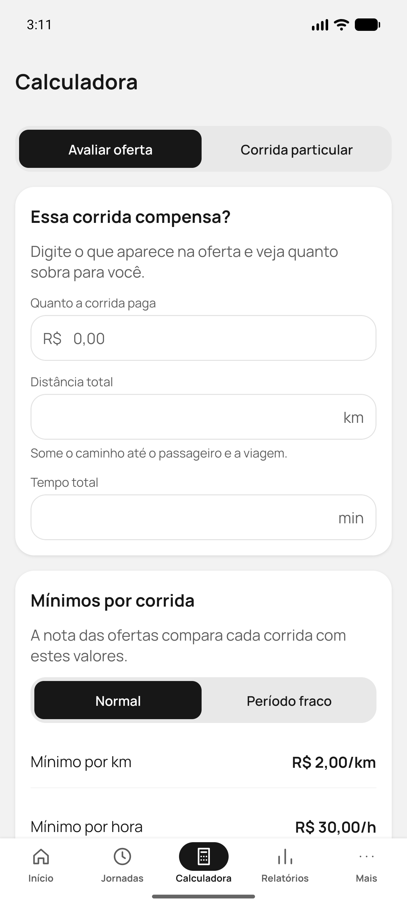
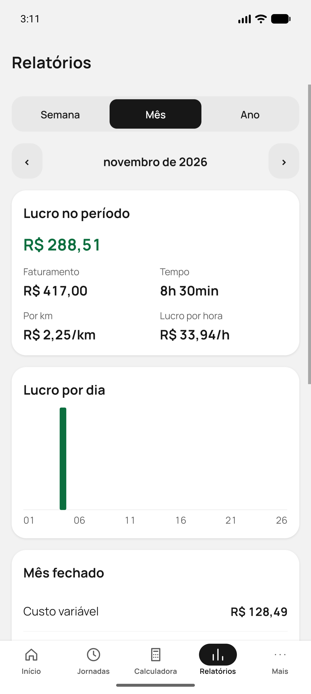
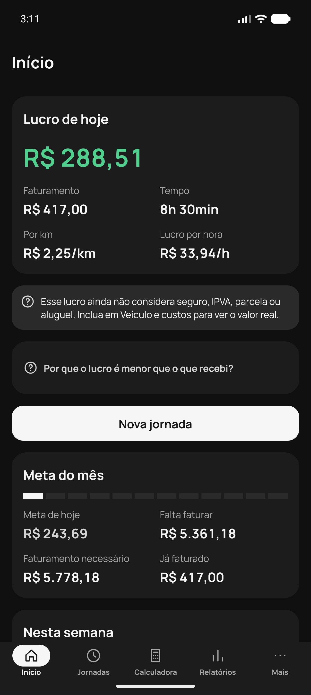
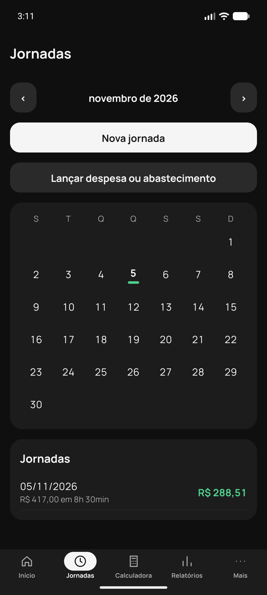
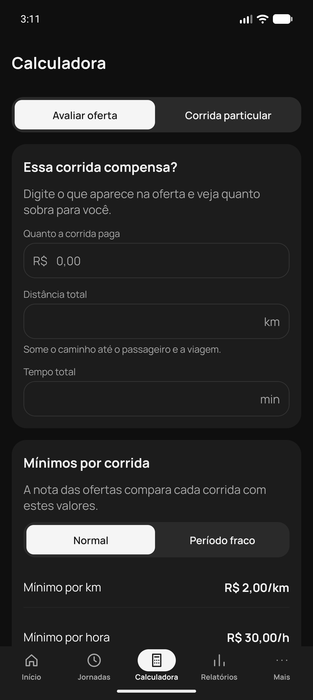
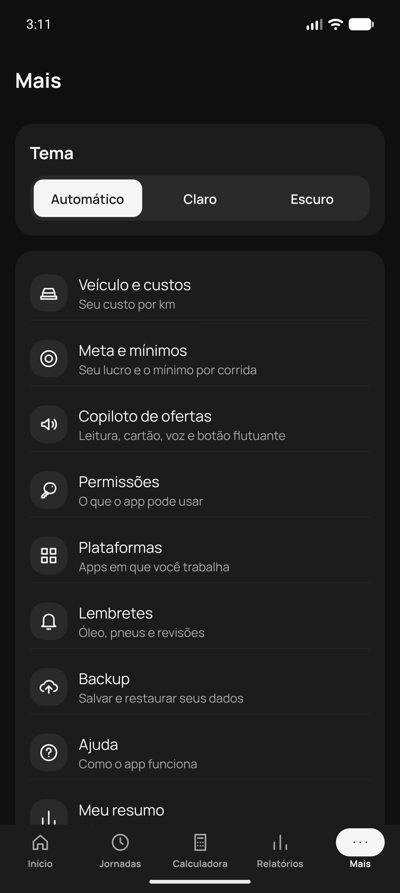

<div align="center">
  

  # Motorista

  **O app gratuito que mostra quanto sobra de verdade no trabalho de motorista.**

  Sem conta. Sem cobrança. Sem anúncios. Seus dados ficam só no seu celular.

  [**Baixar o APK para Android**](https://github.com/Dev-Etto/motorista/releases/latest/download/motorista.apk) · [Todas as versões](https://github.com/Dev-Etto/motorista/releases) · [Relatar um problema ou sugerir uma melhoria](https://github.com/Dev-Etto/motorista/issues/new/choose) · [Apoiar o projeto](https://buymeacoffee.com/contatodevj)
</div>

<p align="center">
  
  
  
  
</p>

<p align="center">
  
  
  
  
</p>

## Por que este projeto existe

Motorista já tem custo demais: combustível, manutenção, seguro, parcela ou aluguel. Uma ferramenta para entender esses números não deveria ser mais um boleto.

O Motorista quer democratizar esse tipo de app. Ele é uma opção profissional e gratuita para quem trabalha com aplicativo ou viagens particulares entender o custo real, cobrar melhor, buscar boas margens e ter mais organização e previsibilidade.

## O que o app faz

- **Custo real por km:** combustível, manutenção, pneus, seguro, IPVA, parcela ou aluguel.
- **Lucro de verdade:** por dia, semana, mês e ano, por km e por hora.
- **Jornadas:** cronômetro, km medidos por GPS e ganhos por plataforma.
- **Calculadoras:** avaliação de ofertas e preço de corridas particulares.
- **Meta e mínimos:** transforma o lucro que você quer em valor por dia e no mínimo que cada corrida deve pagar, por km e por hora.
- **Copiloto de ofertas:** lê a oferta na tela e mostra uma nota de 0 a 10 por cartão, botão flutuante, notificação ou voz.
- **Visual limpo:** preto, branco e cinza, com cor só onde ela informa, como no lucro e na nota da oferta. Tem tema claro e escuro.
- **Mais recursos:** relatórios, lembretes de manutenção e backup em arquivo.

### Você sempre decide

O Copiloto só lê e informa. Ele nunca toca na tela, nunca aceita nem recusa corridas e não envia mensagens. Cada plataforma tem suas próprias regras sobre apps de apoio, e vale conhecê-las.

**Dirigindo, use a voz e não mexa no celular.** Configure e consulte o app só com o carro parado.

## Como instalar

1. Toque em [**Baixar o APK**](https://github.com/Dev-Etto/motorista/releases/latest/download/motorista.apk) no celular Android.
2. Abra o arquivo baixado e permita a instalação quando o Android pedir.
3. Abra o Motorista e siga a introdução.

Para atualizar, instale a versão nova por cima da atual. Seus dados continuam no aparelho, mas vale fazer um backup antes.

O app é distribuído fora das lojas, então o Android pode mostrar avisos extras durante a instalação. Para o Copiloto, o Android também pede a liberação de configurações restritas e da acessibilidade. O passo a passo aparece dentro do app.

> **Situação atual:** versão piloto. O cálculo de custos, jornadas e relatórios já pode ser usado. A leitura automática de ofertas ainda está sendo validada com ofertas reais e pode falhar em alguns aparelhos ou versões das plataformas.

## Privacidade

- Não há conta nem servidor.
- O APK não tem permissão de internet: seus dados não saem do aparelho pelo app.
- Links como este repositório e a página de doação abrem no seu navegador.
- O backup só sai do celular quando você compartilha o arquivo. Ele não tem senha, então guarde em um lugar só seu.
- Os resultados são estimativas feitas com os dados que você informa. Não são aconselhamento financeiro nem fiscal.

## Problemas e sugestões

Encontrou um problema ou teve uma ideia? Conte para a gente, seja motorista ou desenvolvedor. Basta ter uma conta gratuita no GitHub.

- [**Relatar um problema**](https://github.com/Dev-Etto/motorista/issues/new?template=problema.yml)
- [**Sugerir uma melhoria**](https://github.com/Dev-Etto/motorista/issues/new?template=sugestao.yml)

## Contribua com o projeto

O Motorista é gratuito, e você pode ajudar a mantê-lo e a levar novos recursos para mais motoristas, com código ou com apoio financeiro.

- **Com código:** veja a seção [Para desenvolvedores](#para-desenvolvedores) e as [issues abertas](https://github.com/Dev-Etto/motorista/issues).
- **Com apoio financeiro:** use o QR code abaixo ou acesse [buymeacoffee.com/contatodevj](https://buymeacoffee.com/contatodevj).

<p align="center">
  <a href="https://buymeacoffee.com/contatodevj"></a>
</p>

## Para desenvolvedores

Feito com Expo, React Native, TypeScript, SQLite e um módulo nativo em Kotlin. As decisões técnicas estão em [docs/arquitetura.md](docs/arquitetura.md).

```bash
npm install
npm run typecheck
npm test
npm run lint
npm run android
```

`npm run build:apk` gera o APK assinado em `dist/motorista.apk`. Ele exige uma chave de assinatura própria, indicada pelas variáveis `MOTORISTA_KEYSTORE` e `MOTORISTA_KEYSTORE_PASSWORD`.

## Licença

O código é aberto para consulta, estudo e melhorias, mas **a comercialização é proibida**. A licença é a [PolyForm Noncommercial 1.0.0](LICENSE), com uma permissão adicional para motoristas.

- **Pode:** usar o app no seu trabalho de motorista, mesmo sendo remunerado, além de estudar, alterar e compartilhar gratuitamente, mantendo a licença e o aviso de autoria.
- **Não pode:** vender ou alugar o app ou versões derivadas, cobrar por acesso, instalação, recursos ou suporte, exibir anúncios ou incluí-lo em produto ou serviço pago.

Este resumo não substitui o texto do arquivo [LICENSE](LICENSE).

A fonte Manrope, incluída no app, é distribuída sob a [SIL Open Font License](assets/fonts/OFL.txt). Os termos de uso e a política de privacidade ficam dentro do app, em Mais.

Motorista é um projeto independente, sem vínculo com Uber, 99, inDrive ou outras plataformas. As marcas citadas pertencem aos seus donos.
